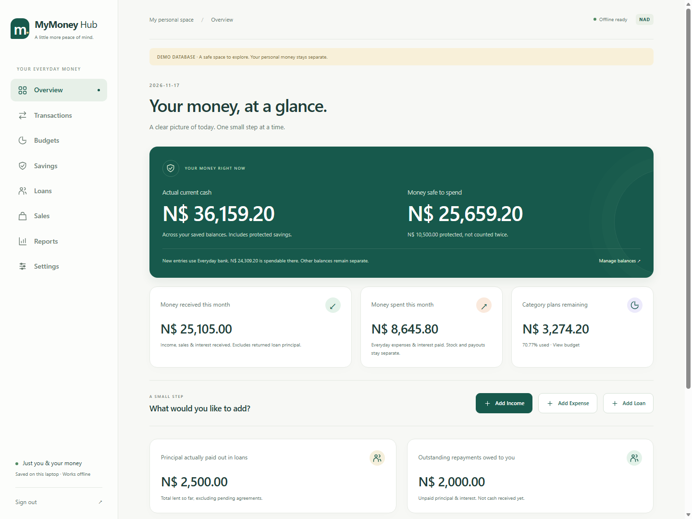
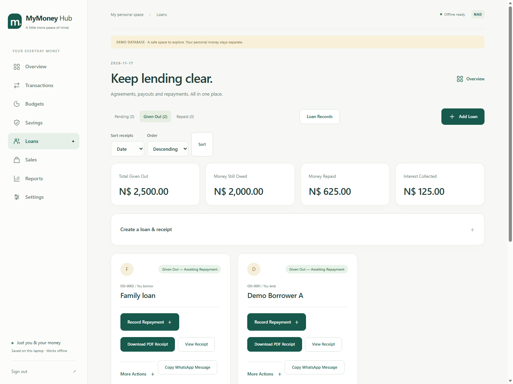

# MyMoney Hub

**A little more peace of mind. Your money, saved on your laptop.**

MyMoney Hub is an offline-first personal finance app for Windows. It brings
everyday spending, protected savings and personal lending into one calm local
workspace, with exact money calculations and a clear record of what actually
happened to your cash.

Built to make daily money management easier without a cloud account, complex
accounting screens or an internet connection during normal use. Currency is
Namibian dollars (NAD); this release supports one local owner per data directory.

## Features

- **Overview:** actual cash, safe-to-spend money, monthly income/spending,
  budgets and money owed to you.
- **Transactions:** income, expenses, optional categories, search, filtering,
  CSV import/export and auditable corrections for ordinary entries.
- **Budgets:** monthly/category plans, spending progress and limit warnings.
- **Protected savings:** reserve existing cash without creating fake income or
  expenses; release it when needed.
- **OSI LOAN:** draft agreements, one-step issuance with receipts, explicit
  fixed-term or annual-simple interest, partial/full repayments and automatic
  Pending / Given Out / Repaid stages. Overdue loans stay under Given Out.
- **Receipts:** offline PDF/TXT downloads, browser printing and a copyable
  WhatsApp message. Nothing is sent automatically. Payment receipts show the
  actual amount received and balance after that payment.
- **Loan Records:** borrower/reference search, status/date filters, repayment
  history and sorting. PDF reports show people who owe you, settled loans or
  complete lending history.
- **Sales:** inventory purchases, FIFO costs, stock limits, cash sales and
  realized gross profit.
- **Local protection:** password hashing, CSRF protection, transactional SQLite
  writes, duplicate-action checks, verified backups and safe schema upgrades.

## Screenshots

The screenshots below are prepared only from an isolated fictional demo.
No personal database, receipt, borrower or financial record is distributed.





## Technologies

Python, Flask, SQLAlchemy, SQLite, Jinja2, vanilla JavaScript and locally stored
CSS. Waitress serves the app on localhost. pytest and standard-library tests
verify finance calculations, persistence and actual HTTP/form workflows.
The offline PDF writer embeds installed Windows Segoe UI fonts; no PDF service
or network request is used.

## Install on Windows

1. Install **Python 3.11 or newer** from [python.org](https://www.python.org/downloads/windows/),
   including the Python launcher and pip.
2. Download this repository using **Code → Download ZIP**, then extract it;
   or clone it with Git.
3. Double-click **Setup MyMoney Hub.cmd**. First setup installs dependencies and
   runs tests. Internet is needed for the initial package download.
4. Double-click **Start MyMoney Hub.cmd**. Keep its server window open.
5. Open `http://127.0.0.1:8765` if the browser does not open automatically.
6. Create your local password (at least 12 characters), set starting money in
   Settings and begin recording your own transactions.

A normal installation starts with **empty financial records**. The demo is
opt-in and separate. Close the server window or press Ctrl+C to stop; reopening
retains saved information. Closing only the browser does not stop the server.

Manual setup from the extracted project directory:

```powershell
py -3 -m venv .venv
.\.venv\Scripts\python.exe -m pip install -r requirements.txt
.\.venv\Scripts\python.exe -m pytest -q
.\.venv\Scripts\python.exe run.py
```

For offline installation, prepare a `wheelhouse` on a connected Windows machine
with matching Python version/architecture:

```powershell
py -3 -m pip download -r requirements.txt -d wheelhouse
```

Copy that folder beside the setup launcher; setup uses `--no-index`. Do not copy
virtual environments between computers.

## How it works

Record **income received** to increase cash and **expenses paid** to reduce it.
Budgets measure spending; savings reservations reduce safe-to-spend money while
leaving actual cash intact. Starting money and internal transfers are not income.

For lending, enter the borrower, principal, rate and dates. **Save Draft** moves
no cash. **Generate Loan & Receipt** records money already handed over exactly
once and makes its official PDF available. N$1,000 at 20% fixed interest means
N$200 interest and N$1,200 total repayable. Expected repayments are not cash.

Use **Record Repayment** for money actually received. Repayments cover interest
first, then principal. After N$500 is received, N$700 remains; receiving the last
N$700 settles the loan. **Pay Full Remaining Amount** fills in the current balance
for confirmation. Reopening a receipt never records another payout.

**More Actions → Delete Receipt** removes only that document's visibility and
download links after confirmation. It does not cancel the loan or change cash,
debt or payment history. Previously downloaded/shared files cannot be revoked.
Direct repayment correction/reversal is not currently supported.

Loan report date ranges select issue/agreement dates. Balances include all
payments saved through report generation; these are not historical as-of-date
balance reports. Lending report totals exclude money you borrow.

### Your name on new receipts

The public build uses the neutral default **Local Lender**. Before launching,
set the name locally in your server process environment:

```powershell
$env:MYMONEYHUB_DISPLAY_NAME = 'Your chosen display name'
.\.venv\Scripts\python.exe run.py
```

No developer's personal lender name is embedded in the public build. Keep any
personalized launcher/configuration private. Receipt identity uses the current
local setting, so retain downloaded receipts if you later change it.

## Privacy and security

- Financial records stay in `%LOCALAPPDATA%\MyMoneyHub-Public\moneyhub.db` by default,
  outside the source directory. This release uses a separate data folder from
  any other MyMoney Hub installation. Backups, exports and receipts remain
  private files you control.
- There is no cloud account, telemetry, CDN or automatic messaging integration.
  GitHub hosts software only; **no personal financial database is included**.
- The server binds to **127.0.0.1**. Keep it local: do not expose it through port
  forwarding, public hosting, tunnels or a LAN bind. Debug mode is off.
- Passwords are securely hashed; sessions use a random local secret. A person
  with access to your Windows files may still access your unencrypted database.
  Use Windows login protection and disk encryption as appropriate.
- Backups include financial data and password hashes. Store them securely.
  Never commit databases, exports, secrets, logs or personal screenshots.

The fictional demo has a documented demo password, generated fixture data and
no real contacts. Test passwords are synthetic test inputs, not user secrets.
Never use the demo password for your personal database.

## Demo

Double-click **Start Demo.cmd**. Its separate database is under the `demo`
subdirectory of the data directory. Password: `ExploreMyMoney!2026`.
All demo borrowers, contacts and transactions are fictional. Running the normal
launcher never imports demo records into your personal data.

## Backup, restore and persistence

Use **Settings → Create & download backup**, and keep another copy on a private
external drive. Schema upgrades verify a backup before changing an existing
versioned database. Closing, shutdown and application upgrades preserve records.

To restore, stop the server first:

```powershell
.\.venv\Scripts\python.exe run.py restore 'D:\PrivateBackups\chosen-backup.db'
```

Restore explicitly replaces the selected active database after you type
`RESTORE`; it retains a safety copy and validates the backup. It is not a merge
tool. Do not restore an older file over newer transactions without checking it.
There is no online password recovery; restoring also restores that backup's
password hash. See [architecture](docs/ARCHITECTURE.md) and
[security guidance](SECURITY.md).

## Tests and project status

Initial public release: **1.0.0**. Supported target: Windows with Python 3.11+.
Release verification details and explicit limits are in
[VALIDATION.md](docs/VALIDATION.md). GitHub Actions uses synthetic temporary
databases and does not upload logs or financial test artifacts.

```powershell
.\.venv\Scripts\python.exe -m unittest discover -s tests_stdlib -v
.\.venv\Scripts\python.exe -m pytest -q
```

Node.js is optional for the JavaScript regression checks; install it to run the
complete frontend checks. The application itself does not need Node.js.

Limits: NAD only, one local owner, whole inventory units, no credit sales,
compounding, automatic penalties or repayment reversal workflow. The database
is not encrypted. PDF export requires installed Windows fonts. CSV import is
additive and rejects duplicate source IDs; exported ledger reports are not
intended as round-trip import files.

## Troubleshooting

- **Old page after upgrade:** close the previous server window, relaunch from
  this folder, then reload the browser. Only one instance may use a data directory.
- **Port occupied:** stop your earlier instance; do not kill unrelated processes.
- **Records appear missing:** check Pending, Given Out and Repaid counts; confirm
  you launched normal mode, not demo or another data-directory override.
- **Setup error:** read the terminal output and check Python/pip installation;
  use the wheelhouse procedure if package downloads are unavailable.
- **PDF font error:** install/restore normal Windows Segoe UI fonts or use the
  receipt view's Print / Save as PDF option.

## Contributing

Read [CONTRIBUTING.md](CONTRIBUTING.md). Use synthetic records and isolated test
directories. Never attach real financial records to a public issue or pull request.

## License

No open-source license has been selected. Public visibility does not grant a
general reuse license. No additional reuse rights are granted by this repository;
contact the repository owner about licensing.
